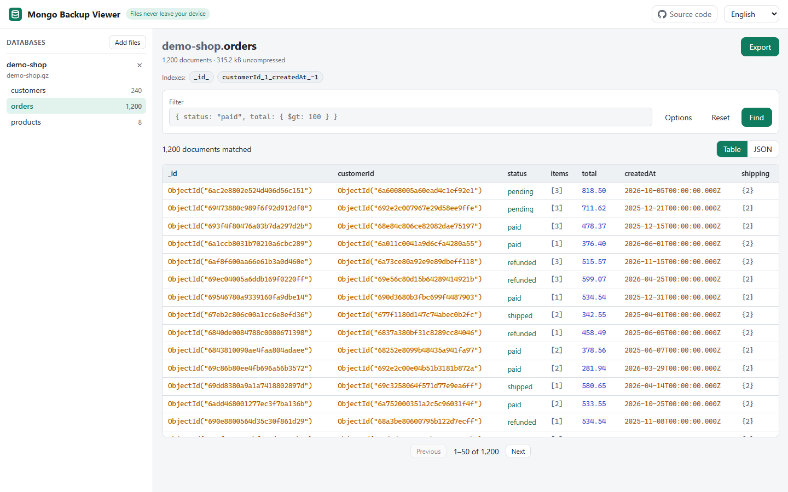

# Mongo Backup Viewer

[](https://github.com/yossef7525/mongo-backup-viewer)
[](LICENSE)
[](https://yossef7525.github.io/mongo-backup-viewer/)

Open MongoDB `mongodump` archives in your browser, filter them with MongoDB queries and export to JSON.

**Live:** https://yossef7525.github.io/mongo-backup-viewer/

If this tool helps you, please ⭐ [star the repo](https://github.com/yossef7525/mongo-backup-viewer).



No archive handy? Click **Try with demo data**, or open `?demo=orders`. Add `?lang=he` (or any supported language code) to pick the UI language, e.g. `?lang=he&demo=orders`.

## Privacy

Files are processed locally in a Web Worker. Nothing is uploaded, there is no analytics and there are no third-party requests. It needs no network after the page loads.

## Features

- Multiple archives and folder drop
- DB/collection tree with counts and indexes
- Table and JSON views
- Full `find` (filter, projection, sort, skip, limit) with shell helpers (`ObjectId()`, `ISODate()`, `NumberDecimal()`, ...)
- Export to JSON, Extended JSON (mongoimport-compatible) and JSON Lines
- Streaming save for large exports in Chrome and Edge
- 10 UI languages, including RTL (Hebrew, Arabic)

## Supported input

Archives created with `mongodump` (100.x archive format) and gzip:

```bash
mongodump --archive=backup.gz --gzip
```

Not supported yet: the directory format (`*.bson.gz`).

## Known limitations

- No `$type` matching on BSON types.
- Integers beyond 2^53 and long decimals are compared approximately in filters (display and export keep the exact values).
- Directory-format dumps (`mongodump --out`) are not supported.
- Aggregation pipelines are not supported, only `find`.

## Query examples

| Goal | Filter |
|---|---|
| Equality and comparison | `{status: "paid", total: {$gt: 100}}` |
| Date range | `{createdAt: {$gte: ISODate("2026-01-01")}}` |
| Search by ObjectId | `{_id: ObjectId("…")}` |
| Several ObjectIds | `{customerId: {$in: [ObjectId("…"), ObjectId("…")]}}` |
| Extended JSON ObjectId | `{"_id": {"$oid": "…"}}` |
| Regex | `{email: {$regex: "@example\\.com$", $options: "i"}}` |

Replace `…` with a real 24-character hex id.

## Browser support

Chrome and Edge work best (streaming save). Firefox and Safari export through an in-memory download. Memory use is roughly the uncompressed size of the open archives.

## Development

Requirements: Node 22+ for development.

```bash
npm ci
npm run dev
npm test
npm run demo   # regenerate public/demo.gz
MBV_SAMPLE=/path/to/backup.gz npx vitest run src/archive/realSample.test.ts
```

## Translations

Non-English translations were machine-drafted. Native-speaker review is welcome, see [CONTRIBUTING](CONTRIBUTING.md).

## License

[MIT](LICENSE)
